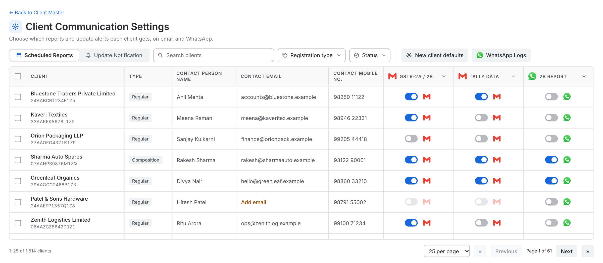
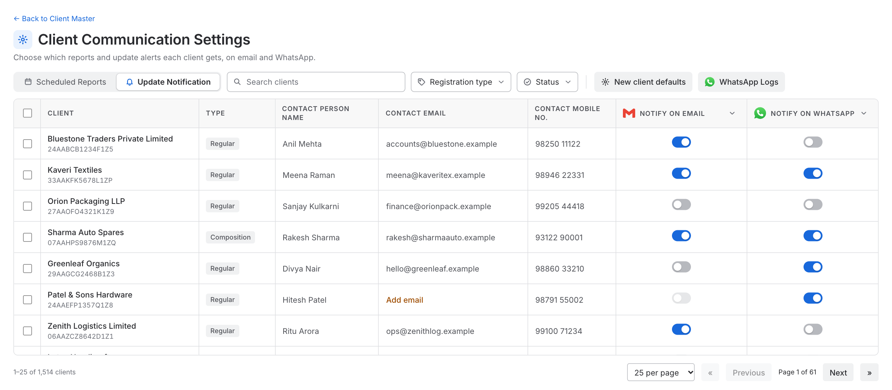
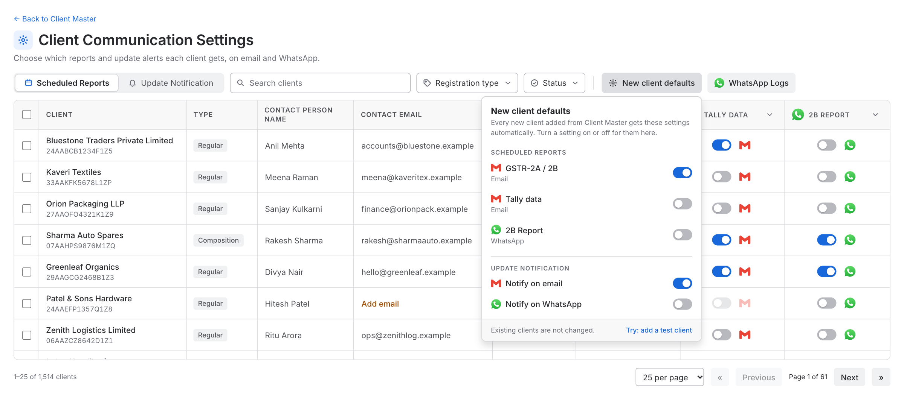
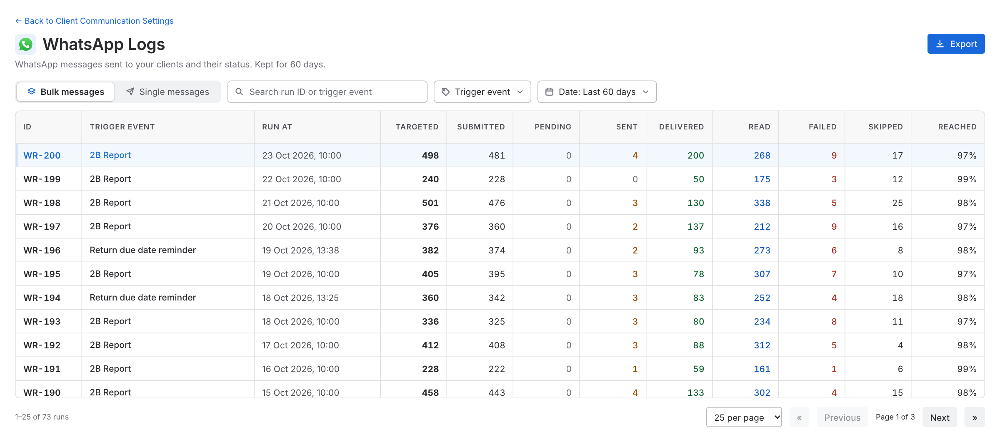
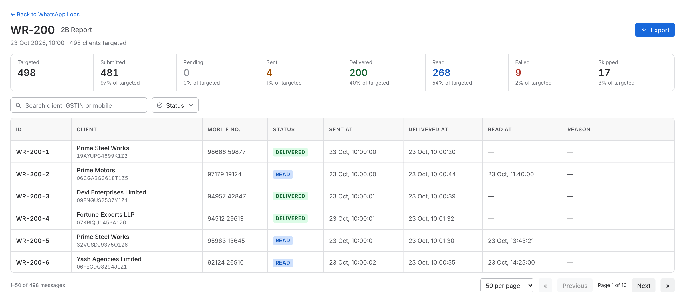
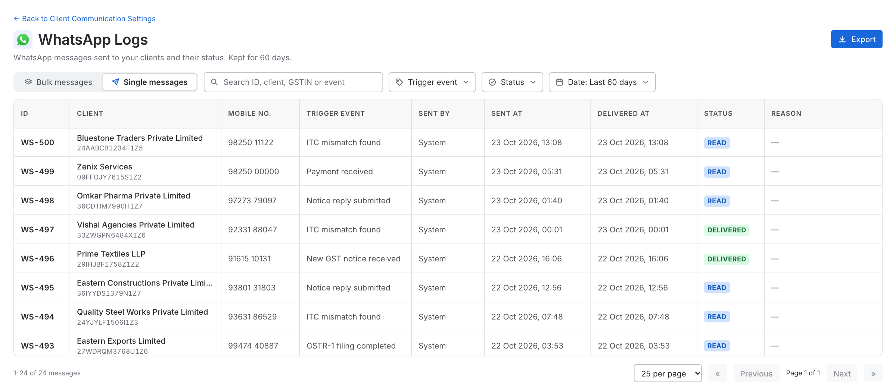

# Client Communication Settings and WhatsApp Logs: Business Requirements Document

| | |
|---|---|
| **Product** | Spectrum Cloud |
| **Module** | GST |
| **Feature** | Client Communication Settings (existing page, new look) and **WhatsApp Logs (new)** |
| **Document status** | Draft v1 |
| **Prototype** | https://kartikkhandelwal-pm.github.io/client-communication-settings/ (sample data only) |

---

## 1. Overview

### 1.1 Background

In the GST module, a firm can choose which messages each of its clients receives automatically:

- **Scheduled reports**, for example the GSTR-2A / 2B report, the Tally data and the 2B Report.
- **Update notifications**, which tell a client when something happens to their data.

Each can go out by **email** or by **WhatsApp**. This is set on the **Client Communication Settings** page, one client per row. The user can also send a report to one client straight away by clicking the email or WhatsApp icon in that client's row.

The page exists today. Emails sent from it can be seen in **Email Logs** (a separate feature, see the Email Logs BRD). **WhatsApp messages have no log.** The user cannot see how many clients a scheduled WhatsApp run was meant for, how many messages were actually sent, or what happened to them.

### 1.2 What we are doing

Two things:

1. **Refresh the look of the Client Communication Settings page.** The entry point and all of its functions stay the same. Only the layout, tables and filters are redone, to match Email Logs.
2. **Add WhatsApp Logs (new).** A page where the user can see every WhatsApp message sent **from this page**: for a scheduled run, how many clients were targeted, how many messages were sent, and the status of each. A **WhatsApp Logs** button on the settings page opens it.

### 1.3 Goals

The user can:

1. Keep doing everything they do on the settings page today, with the same entry point.
2. See, for every scheduled or update-notification WhatsApp run, **how many clients were targeted** and what happened to the messages.
3. See the status of every WhatsApp message, and the reason when it did not reach the client.
4. Find a particular run, client or message quickly (search, filters, export).

### 1.4 Scope

| In scope for this version | Out of scope for this version |
|---|---|
| New look for the Client Communication Settings page (same functions) | Changing what the settings page does |
| **WhatsApp Logs** page: bulk runs, single messages, per-message status | Logs for WhatsApp messages sent from anywhere else (other pages or other modules) |
| Search, filters, date range, export (CSV) | Showing the text of the message |
| Status and failure reason from Rampwin | Resending a message from the logs page |
| A **WhatsApp Logs** button on the settings page | Email logs (already covered by Email Logs) |
| | Showing, on the settings page, how many clients the **next** scheduled run will target (to be discussed later; needs changes to the screen) |

> **Only messages sent from this page are logged.** This means the scheduled WhatsApp report, update notifications, and the Send button on this page. WhatsApp messages sent from any other place in Spectrum Cloud are not shown.

---

## 2. Key concepts

Read this section first. The rest of the document uses these terms.

### 2.1 Two groups of settings

| Group | What it is | Tab on the settings page |
|---|---|---|
| **Scheduled reports** | A report sent to the client on a schedule. Today: GSTR-2A / 2B (email), Tally data (email), 2B Report (WhatsApp) | **Scheduled Reports** |
| **Update notifications** | A message to the client when something happens (an *event*). Two settings: Notify on Email, Notify on WhatsApp | **Update Notification** |

Each setting is a switch per client. Clients with no email address cannot get email settings. Clients with no mobile number cannot get WhatsApp settings. Their switch is greyed out.

### 2.2 Two kinds of WhatsApp messages in the logs

| Kind | What it is | Where it shows |
|---|---|---|
| **Bulk message** | One run that goes **to many clients together at a scheduled time**. Example: the 2B Report that goes to every client whose switch is on | **Bulk messages** tab. Opening one shows every client's message inside it |
| **Single message** | One message **to one client**. Example: the Send button on the settings page, or an update notification for one client's event | **Single messages** tab |

**The rule:** sent together to many clients at one time = Bulk. Sent to one client = Single.

A bulk run can have thousands of clients, so each run has **its own page**.

### 2.3 Trigger event

Every message is sent because of something. We call this the **trigger event**: the name of the place or event the message was sent from. It is the same idea as the trigger event in Email Logs.

**List of all trigger events and their names:** `{Link to be added by the domain team}`

For every trigger event the domain team gives us:

- the **trigger event name** (shown to the user), and
- whether it is sent as a **bulk run** (to everyone together at a set time) or as a **single message** (to one client).

> **Placeholder.** The names on the prototype screens (for example "GSTR-2B data updated", "Return due date reminder", "Payment received") are **examples only**. Only **2B Report** is a real name, because it is on the settings page today. The final list will be added by the domain team.

### 2.4 IDs the user sees

Users never see Rampwin's codes. They see short IDs made by Spectrum Cloud.

| What | Format | Example |
|---|---|---|
| Bulk run | `WR-` + number | `WR-200` |
| One message inside a bulk run | run ID + position | `WR-200-1`, `WR-200-2` … |
| Single message | `WS-` + number | `WS-501` |

### 2.5 Numbers and statuses

**Numbers for a bulk run**

| Number | Meaning |
|---|---|
| **Targeted** | Clients selected for this run: those whose switch was **on** when the run started |
| **Submitted** | Messages handed to WhatsApp (targeted minus skipped) |
| **Skipped** | Targeted but **not sent**, for example the client has no valid WhatsApp number |
| **One count per status** | How many messages are in each status (below) |
| **Reached** | Delivered + Read, as a percentage of Submitted |

The numbers add up: **Targeted = Submitted + Skipped**, and Submitted is the total of all the status counts.

**Statuses.** The status of every message is **taken from Rampwin** and shown as Rampwin gives it, in plain words (for example Pending, Sent, Delivered, Read, Failed). The final list follows what Rampwin provides. **Skipped** is our own status for a message we did not send.

---

## 3. How the user opens the page

**Entry point (unchanged).** In the GST module there is a **profile drawer**. It has a **Client Settings** tab. Clicking this tab opens the **Client Communication Settings** page.

**WhatsApp Logs (new).** A **WhatsApp Logs** button on the settings page opens the logs. The logs page has a **Back to Client Communication Settings** link.

---

## 4. The Client Communication Settings page

> All the functions on this page are **the same as today**, including saving each switch on its own and editing the contact details in the table. This section describes the page as it is in the prototype, so the team can check that nothing was lost.

### 4.1 Toolbar

From left to right:

- **Tabs:** Scheduled Reports, Update Notification.
- **Search:** by client name, GSTIN, contact person, email or mobile number.
- **Filters:** Registration type (Regular / Composition), and Status (all, something turned on, all turned off, missing email or mobile).
- **New client defaults** and **WhatsApp Logs** buttons, after a thin divider. These are action buttons, not filters.

Filters read the same way everywhere: "Status" when nothing is picked, "Status: Read" when something is.

### 4.2 Table

One row per client.

| Column | Notes |
|---|---|
| Checkbox | Select clients for a bulk change |
| Client | Name, with the GSTIN below it |
| Type | Regular / Composition |
| Contact Person Name | Click to edit |
| Contact Email | Click to edit. "Add email" in orange when missing |
| Contact Mobile No. | Click to edit. "Add mobile no." in orange when missing |
| **Scheduled Reports tab:** GSTR-2A / 2B (email), Tally Data (email), 2B Report (WhatsApp) | A switch, and a **send icon** (email or WhatsApp logo) |
| **Update Notification tab:** Notify on Email, Notify on WhatsApp | A switch |

**Switches.**

- Each change is saved on its own, with a short "Saved" message.
- The ▾ button in a column title turns that setting on or off **for all listed clients**.
- Tick one or more clients (the top checkbox ticks all clients on the page). A bar appears above the table: pick a setting, then turn it **On** or **Off** for the ticked clients only.
- A client with no email (or no mobile number) has that switch greyed out. Taking away an email turns that client's email settings off.

### 4.3 Send icon (Scheduled Reports tab)

Clicking the email or WhatsApp icon next to a setting **sends that report to that client straight away**, even when the switch is off. There is no confirmation. The icon shows a spinner, then a tick, and a message says what was sent and to whom. It is greyed out when the client has no email or mobile number. There is no warning if the same report was sent a few minutes earlier.

A **WhatsApp** send from this icon is written to the WhatsApp Logs as a **Single message** (section 5.5). An **email** send is written to Email Logs, as it is today.

### 4.4 New client defaults

The user chooses which settings are **on** for a **new client**. Every new client added from Client Master gets these settings **automatically**. Existing clients are not changed.

### 4.5 Paging

25, 50 or 100 clients per page, with first, previous, next and last page. The page works with thousands of clients: the table scrolls, and the header and first two columns stay in view.

---

## 5. WhatsApp Logs (new)

### 5.1 What it shows

Every WhatsApp message sent **from the settings page**, in two tabs: **Bulk messages** and **Single messages**. Logs are kept for **60 days** (a setting that can be changed later).

### 5.2 Toolbar

- **Search:** Bulk tab by run ID or trigger event. Single tab by ID, client, GSTIN or trigger event.
- **Filters:** Trigger event, Status (Single tab only), Date. A filter with 8 or more choices gets a search box.
- **Date:** Last 60 days, Last 30 days, Last 7 days, Today (since midnight). Cannot go beyond the retention limit.
- **Export:** downloads what is on screen as a CSV file. The CSV also has the GSTIN as its own column.

### 5.3 Bulk messages tab

One row per **run** (for example, the 2B Report of one day). A run answers: **how many clients were targeted that day, and what happened.**

| Column | Notes |
|---|---|
| ID | `WR-…` |
| Trigger event | From the domain list. Today: **2B Report** |
| Run at | When the run started |
| **Targeted** | Clients selected for this run |
| Submitted | Messages handed to WhatsApp |
| One column per status | For example Pending, Sent, Delivered, Read, Failed. Follows the statuses Rampwin gives |
| Skipped | Not sent, for example no valid WhatsApp number |
| Reached | Delivered + Read, out of Submitted |

### 5.4 When the user clicks a run: the run page

A separate page. It shows:

- The run ID, the trigger event, when it ran, and how many clients were targeted.
- **Summary cards:** Targeted, Submitted, one card per status, and Skipped, each with its share of targeted.
- A table with **one row per client message**, with search and a Status filter.

| Column | Notes |
|---|---|
| ID | `WR-200-1` (run ID + position) |
| Client | Name, with the **GSTIN** below it |
| Mobile no. | |
| Status | |
| Sent at | |
| Delivered at | |
| Read at | |
| Reason | The failure or skip reason |

### 5.5 Single messages tab

One row per message sent to one client.

| Column | Notes |
|---|---|
| ID | `WS-…` |
| Client | Name, with the **GSTIN** below it |
| Mobile no. | |
| Trigger event | From the domain list. **2B Report** when sent with the Send icon |
| Sent by | A person (Send icon), or **System** |
| Sent at | |
| Delivered at | |
| Status | |
| Reason | The failure reason |

---

## 6. Where the data comes from

We send WhatsApp through **Rampwin**. **The status of every message and its delivery details (delivered time, read time, failure reason) are taken from Rampwin.** The user must never see the name Rampwin or its codes.

- Rampwin API reference: https://rampwin-api.readme.io
- Rampwin help docs: https://docs.rampwin.com

**What Spectrum Cloud must save when it sends** (Rampwin does not know these):

1. Our own ID (`WR-…`, `WS-…`) next to Rampwin's reference for the message.
2. The **trigger event**, and whether it is a bulk run or a single message.
3. For a bulk run: the **number of clients targeted** and the list of clients, **at the moment the run starts**. Switches can change later, so this cannot be worked out afterwards.
4. For every client: the **GSTIN** and **mobile number** used, and whether the client was **skipped** (and why).
5. Who sent it (a person, or System), and the time.

---

## 7. Rules

1. **Only messages sent from the settings page are logged.** Messages from anywhere else are not.
2. A message is logged once, and its status is updated as Rampwin reports it.
3. **Targeted** is fixed when the run starts. Changing a switch afterwards does not change old runs.
4. A client with no WhatsApp number is **Skipped**, and still counts in Targeted.
5. The Send icon works whatever the switch says, and its WhatsApp messages appear under Single messages.
6. Logs older than 60 days are not shown. The number of days is a setting and can be changed later.
